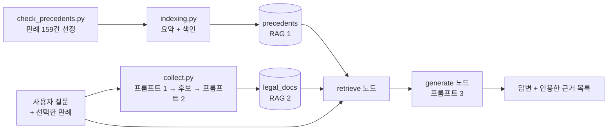

# RAG 파이프라인 설계문서

임대차 판례 RAG · SSAFY AI 코어 프로젝트 2회차

## 1. 전체 흐름



- 판례 색인(RAG 1)은 미리 한 번 만든다.
- 외부 문서(RAG 2)는 질문이 들어올 때 필요한 것만 모은다. 같은 질문은 다시 모으지 않는다.
- 답변은 LangGraph의 두 노드(retrieve → generate)가 만든다.

## 2. 두 컬렉션 구조

| 항목 | precedents (RAG 1) | legal_docs (RAG 2) |
| --- | --- | --- |
| 내용 | 판례 1건의 판시사항·판결요지·참조조문·일상어 요약 | 법령 조문, 판결문 전문, (선택) 법령해석례 |
| 청크 단위 | 판례 1건 = 청크 1개 (최대 3000자) | 1000자, 중복 200자 |
| ID | 판례일련번호 (예: 619451) | 항목ID:문서ID:순번 (예: common:law276291-제3조:0, 619451:prec619451:2) |
| 다시 색인 | 같은 ID라 덮어쓰기. 개수가 늘지 않음 | 첫 청크 ID가 있으면 건너뜀 |

항목 ID 규칙: 법령 조문은 여러 판례가 함께 쓰므로 `common`, 판결문은 그 판례의 `판례일련번호`를 쓴다. 판례를 고른 질문은 `case_id in [선택 판례, ""]` 필터로 검색해, 다른 판례의 판결문이 섞이지 않는다.

### 메타데이터 필드

precedents

| 필드 | 쓰임 |
| --- | --- |
| source_type = "판례" | 근거 목록에서 "판례 메타데이터"로 표시 |
| case_id, case_no, case_name, court, date, year | 표시, 원문 링크, 연도 |
| kind (주택/상가) | 판례 찾기 필터, 다른 법 조문 제외 |
| issues, main_issue | 쟁점별 목록 좁히기, 요건 점검 |
| display_name | 화면 표시명 "[쟁점] 한 줄 제목 · 법원 사건번호 (연도)" |
| refs | 참조조문 |
| plain_generated | 일상어 요약 생성 여부 |
| source_url | 국가법령정보센터 공개 페이지 (인증키 없음) |

legal_docs

| 필드 | 쓰임 |
| --- | --- |
| source_type (법령/판결문/해석례) | 근거 종류 표시 (F2016) |
| doc_id, chunk | 문서 단위 조회, 순번 |
| title, law_name, article_no, effective_date | 표시, 시행일 |
| case_id | 판결문이 속한 판례. 법령은 "" |
| issues, issue_대항력 등 | 쟁점 필터 (Chroma는 부분 문자열 필터가 없어 쟁점마다 참/거짓 필드를 둔다) |
| query | 이 문서를 고르게 한 검색어 (검증 4.2) |
| collected_at, source_url | 수집일, 출처 |

## 3. 문서 수집 · 청킹 · 색인 순서

### 3.1 판례 (RAG 1)

1. `check_precedents.py`가 법제처 판례 API에서 임대차 판례를 모은다. 쟁점 4개(대항력, 우선변제권, 보증금반환, 계약갱신)와 종류(주택, 상가)로 분류해 159건을 고른다.
2. `indexing.py precedents`가 판례마다 일상어 요약과 한 줄 제목을 만든다. 결과는 `data/summaries.json`에 캐시한다.
3. 판례 1건을 아래 템플릿의 텍스트 1개로 만든다. 3000자를 넘으면 판결요지 뒤쪽을 줄이고, 참조조문은 항상 남긴다.

```
[사건명]
사건번호 | 법원 | 선고일 | 구분 | 쟁점
일상어 요약: ...
판시사항: ...
판결요지: ...
참조조문: ...
```

### 3.2 외부 문서 (RAG 2), 질문마다

1. 프롬프트 1이 질문과 선택한 판례에서 확인할 조문과 법률 용어를 뽑는다.
2. 법령 API로 4개 법령(주택임대차보호법, 같은 법 시행령, 상가건물 임대차보호법, 같은 법 시행령)의 조문을 모두 읽는다. 응답은 `data/raw/`에 캐시한다.
3. 후보를 만든다. 지정한 조문은 그대로 넣고, 용어는 낱말이 모두 들어 있는 조문을 넣는다. 최대 20건이다.
4. 프롬프트 2가 후보의 제목과 앞 80자만 보고 필요한 문서를 최대 8건 고른다.
5. 선택한 판례의 판결문 전문은 선별과 관계없이 항상 넣는다. 전문이 없으면 판시사항·판결요지로 대신하고 제목에 "(전문 미제공)"을 붙인다.
6. 고른 문서를 1000자 청크로 나눈다. 청크마다 `[문서 제목]`을 앞에 붙여, 둘째 청크도 어느 조문인지 알 수 있게 한다.
7. `data/collected.json`에 질문 키(판례 ID + 질문)를 기록한다. 같은 질문은 1~4단계를 건너뛴다 (NF2002).

외부 호출 예절 (NF2006): 호출 사이 0.4초 대기, 실패 시 3번 재시도, 오류 응답은 캐시하지 않는다.

## 4. 검색 결과 병합과 중복 제거

`retrieval.retrieve()`

1. 판례 근거
   - 판례를 골랐으면 그 판례의 청크를 검색 없이 근거 1번으로 넣는다.
   - 고르지 않았으면 질문과 비슷한 판례 2건을 넣는다.
2. 외부 문서 근거: legal_docs에서 Top-k의 2배를 찾는다. 상가 판례면 주택법 조문을, 주택 판례면 상가법 조문을 뺀 뒤 Top-k개로 자른다.
3. 병합: 판례 근거 → 외부 문서 근거 순서로 잇는다.
4. 중복 제거: 같은 ID, 또는 공백을 정리한 본문이 같은 청크는 한 번만 남긴다.

리스트 순서가 곧 근거 번호다.

## 5. 프롬프트

| 프롬프트 | 역할 | 입력 | 출력 형식 |
| --- | --- | --- | --- |
| 1 검색어 추출 (QUERY_PROMPT) | 법률 전문가 역할로 확인할 조문과 용어를 정한다 | 선택한 판례 요약, 질문 | `{"articles": ["법령명 제N조"], "keywords": ["용어"]}` |
| 2 후보 선별 (SELECT_PROMPT) | 리서처 역할로 질문에 직접 필요한 문서만 고른다. 판례와 같은 법을 우선한다 | 판례, 질문, 후보 목록(제목 + 앞 80자) | `[1, 4, 7]` |
| 3 답변 생성 (ANSWER_PROMPT) | 근거만 써서 답하고 문장마다 근거 번호를 단다 | 판례, 이전 대화 4개, 근거, 질문 | 본문 + `[근거 N]`, 그다음 확인할 요건 목록 |

프롬프트 3의 핵심 규칙

- 근거에 없는 조문 번호·기간·금액·결론을 쓰지 않는다. 없으면 "제공된 문서에서 확인되지 않습니다."라고 쓴다.
- 사건 결과를 예측하지 않고, "네/아니요"로 시작하지 않는다. 원칙 → 확인할 요건 순서로 쓴다.
- 일상어 요약은 검색용 생성 문장이라 인용하지 않는다.

JSON 출력이 깨지면 안전한 기본값을 쓴다. 프롬프트 1이 실패하면 질문 자체를 용어로 쓰고, 프롬프트 2가 실패하면 앞에서부터 8건을 쓴다.

## 6. 청크 크기 · 중복 길이 · Top-k

| 값 | 설정 | 이유 |
| --- | --- | --- |
| 판례 청크 | 1건 = 1청크, 최대 3000자 | 판례는 판시사항·요지·참조조문이 함께 있어야 뜻이 통한다. 나누면 "어느 판례의 어느 부분"인지 흐려진다 |
| 외부 문서 CHUNK_SIZE | 1000자 | 조문 135개 중 127개가 1000자 안에 들어가 조문 1개 = 청크 1개가 된다. 긴 조문(상가법 제10조 등)과 판결문만 나뉜다 |
| CHUNK_OVERLAP | 200자 | 항(①②)이 청크 경계에서 잘려도 앞뒤 문맥이 남는다 |
| TOP_K | 6 | 판례 근거 1~2건 + 외부 6건이면 근거가 8건 안팎이다. 답에 필요한 조문은 보통 1~3개라 충분하고, 더 늘리면 관계없는 조문이 섞인다 |
| GENERAL_PRECEDENT_K | 2 | 판례 없이 물을 때도 비슷한 판례를 함께 보여 준다 |

값을 바꿨을 때의 차이

질문 "주택 임차인의 대항력은 언제부터 생기나요?"로 Top-k만 바꿔 비교했다 (`python src/ask.py "..." --top-k N --all --no-collect`, 2026-10-22).

| Top-k | 검색된 근거 | 답에 필요한 조문 (주택법 제3조) | 관계 적은 근거 | 인용한 근거 |
| --- | --- | --- | --- | --- |
| 3 | 5건 (판례 2 + 외부 3) | 3번 | 주택법 제10조, 상가법 제3조 | 제3조 1건 |
| 6 | 8건 (판례 2 + 외부 6) | 3번 | 위 2건 + 주택법 제6조의3, 상가법 제7조 등 | 제3조 1건 |
| 12 | 14건 (판례 2 + 외부 12) | 3번 | 나머지 11건: 갱신·차임 조문, 상가법 제3조·제7조·제10조, 다른 사건 판결문 2청크 등. 임차권등기명령(제3조의3)만 대항력과 관련 있음 | 제3조 1건 |

- 세 경우 모두 필요한 조문이 3번에 들어왔고 답의 결론이 같았다. 이 질문은 답이 조문 하나에 있어 Top-k의 영향이 작다.
- Top-k 12에서는 근거의 절반 이상이 질문과 관계가 적었다. 프롬프트가 길어지고, 모델이 관계없는 조문을 인용할 위험이 커진다. Top-k 12의 답에는 "'마친 때'와 '그 다음 날'을 기준으로 정리할지" 같은 어색한 요건 줄도 생겼다.
- Top-k 3은 이 질문에는 충분했다. 그러나 답이 여러 조문에 걸치는 질문(예: 갱신요구 기간 = 제6조의3 + 제6조, 증액 한도 = 제7조 + 시행령 제8조)에서는 필요한 조문이 빠질 수 있다.
- 그래서 둘 사이의 6을 기본값으로 정했다.

청크 크기·중복 길이를 바꿨을 때 법령 조문의 청크 수 (`python src/indexing.py chunks`, 색인은 바꾸지 않음)

법령 4개의 조문 135개 기준 (2026-10-22)

| 크기 / 중복 | 청크 수 | 2개 이상으로 나뉜 조문 | 가장 많이 나뉜 조문 |
| --- | --- | --- | --- |
| 500 / 100 | 174 | 26개 | 4청크 |
| 1000 / 200 (사용) | 143 | 8개 | 2청크 |
| 2000 / 200 | 135 | 0개 | 1청크 |

- 설정을 바꾸면 청크 수가 달라진다 (검증 4.2).
- 500자로 줄이면 조문 26개가 나뉜다. 한 조문의 항들이 여러 청크로 흩어져, 검색 결과가 한 조문의 청크로 몰리고 다른 조문이 밀려난다. 근거 하나만 보고는 조문 전체 뜻을 알기 어렵다.
- 2000자로 늘리면 모든 조문이 청크 1개가 된다. 그러나 판결문 전문은 수천~수만 자라 2000자 청크도 여러 개 생기고, 청크 하나에 쟁점이 여러 개 섞여 검색 정확도가 떨어진다. 프롬프트도 길어진다.
- 1000자에서는 135개 중 127개(94%)가 조문 1개 = 청크 1개다. 긴 조문 8개만 2청크로 나뉜다. 조문 단위를 거의 지키면서 판결문은 쟁점 단위로 나눌 수 있어 1000/200을 골랐다.

## 7. 근거 표시 방식 (F2008)

1. 근거마다 `[근거 N] (출처 종류) 제목` 형식으로 프롬프트에 넣는다. 출처 종류는 판례 메타데이터 / 법령 / 판결문 / 해석례다.
2. 답변에서 `[근거 ...]` 표시를 모두 찾아 숫자를 뽑는다. `[근거 1, 3]`과 `[근거 4, 근거 3]` 형식을 모두 읽는다.
3. 화면에는 실제로 인용한 근거만 "답변에 사용한 근거 N건"으로 보여 준다. 근거마다 출처 종류, 제목, 시행일 또는 선고일, 원문 링크를 붙인다.
4. 인용한 근거가 하나도 없으면 그 사실을 화면에 안내한다.
5. 판례나 판결문을 인용하면 "선고 당시의 법령을 기준으로 한 판단"이라는 안내를 코드가 붙인다. 프롬프트에만 맡기면 빠질 때가 있었기 때문이다.

## 8. 도메인 특화 기능 설계 이유

### 요건 점검 (F2010)

- 임대차 분쟁의 질문은 대부분 "내가 이 권리를 가지고 있나요?"다. 답은 법이 정한 요건을 하나씩 맞춰 보는 것이다.
- 결과를 예측하면 법률 자문이 된다. 그래서 요건마다 "상황에서 확인됨 / 추가 확인 필요 / 상황에 정보 없음" 세 상태만 표시한다.
- 요건은 근거(쟁점 조문 + 선택한 판례 또는 같은 쟁점의 판례 2건)에서만 뽑는다. 표의 모든 행에 근거 번호가 붙는다.

### 조건 기반 판례 찾기 (F2011)

- 일반인은 사건번호나 법률 용어를 모른다. "건물이 팔린 뒤 보증금을 못 받았어요"처럼 상황으로 찾아야 한다.
- 의미 검색만 쓰면 비슷한 말이 든 다른 종류(주택/상가) 판례가 섞인다. 그래서 조건에 주택이나 상가가 있으면 메타데이터 필터를 걸고, LLM이 후보 20건 중 관련 있는 것만 고른다.
- 카드에서 바로 그 판례로 대화를 시작할 수 있게 했다.

## 9. 선택 이유, 겪은 문제와 해결

| 문제 | 원인 | 해결 |
| --- | --- | --- |
| 판례 원문 링크에 인증키가 들어감 | API의 판례상세링크에 OC 값이 포함됨 | 인증키 없는 국가법령정보센터 공개 주소(precInfoP.do)로 직접 만든다 |
| 조문 "제3조의2"가 "제3조"로 읽힘 | API의 조문번호에 가지번호가 빠짐 | 조문내용 앞부분에서 "제N조의M"을 읽어 조문 라벨을 만든다 |
| 항이 있는 조문의 본문이 비어 있음 | 본문이 항·호·목 필드에 나뉘어 있음 | 항·호·목을 순서대로 펼쳐 한 텍스트로 만든다 |
| 같은 질문인데 매번 다시 수집함 | LLM이 검색어를 매번 조금씩 다르게 뽑음 | 수집 기록 키를 검색어가 아니라 판례 ID + 질문 텍스트로 바꿨다 |
| 긴 용어("임대차 해지 통지")로 후보가 0건 | 용어 전체가 붙어 있는 조문만 찾음 | 낱말이 모두 들어 있으면 후보로 본다 |
| 2026년 판례의 판결문이 비어 있음 | API가 오류 응답을 주고, 그 응답이 캐시됨 | 오류 응답을 알아보고 캐시하지 않는다. 전문이 없으면 판시사항·요지로 대신한다 |
| 상가 판례인데 주택 조문을 고름 | 두 법에 같은 이름의 조문이 많음 | 프롬프트 2에 판례를 보여 주고, 검색 뒤에 다른 법 조문을 뺀다 |
| 근거 목록이 인용보다 적게 나옴 | 모델이 `[근거 4, 근거 3]` 형식을 씀 | 인용 표시를 넓게 찾고, 그 안의 숫자를 모두 읽는다 |
| 화면에 `**`가 그대로 보임 | 한글 조사와 붙은 굵은 글씨가 마크다운으로 안 읽힘 | 프롬프트로 금지하고, 출력에서도 지운다 |
| 판례 찾기 결과 0건 | "조건의 모든 요소가 맞아야 고른다" 규칙이 너무 엄격함 | 핵심 상황·쟁점이 관련 있으면 고르게 바꾸고, 주택/상가 필터를 먼저 건다 |

## 10. RAG 효과 요약

자세한 내용은 [results/compare_summary.md](results/compare_summary.md)에 있다.

- RAG 없이 답하면 6문항 중 4문항에서 틀리거나 존재하지 않는 조문을 댔다. 예) 묵시적 갱신 후 해지 효력을 "1개월"로 답함, "민법 제635조의2" 인용.
- RAG를 쓰면 판정 대상 5문항이 모두 맞았고, 모든 인용이 색인된 실제 조문이었다.
- 문서에 없는 질문에는 RAG만 "확인되지 않습니다"라고 답했다.
